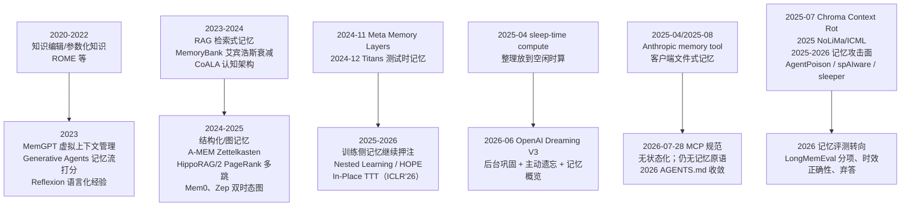

# 05 · AGI 方向上的「记忆」：前沿、可下注之处、对我们的直接建议

> 调研日期 2026-10-17。范围：记忆增强 agent、模型/训练侧记忆、巩固与遗忘、批评与反例、接口层长期赌注。
> 纪律：分清「论文/厂商宣称」与「可复现事实」；查不到写「未找到公开资料」。
> 前情：旧项目 `/Users/yangfu/yffto/dsh-engramory-recall` 是「一篇笔记一个 md + 200 行钩子索引 + 每轮 BM25 push 指针注入」，
> 实测 push 指针打开率 **2.86%**（口径：去重后打开条数 ÷ 注入指针条数，560 次携带里被真读过 16 次，实测日 2026-10-16；
> 见其 `docs/measuring.md:155`；定义见 `README.md:202-203` 与 `docs/how-it-works.md:196-198`）。
> 注意分母敏感：同仓库另有「基础打开率 = 被读过次数 ÷ 被带进上下文次数」的口径（`confidence.js:76`），
> 以及一条 4.1% 的旧记录（`CHANGELOG.md:13`）——**换分母就能把同一套数据讲成 2.86% / 4.1%**，这本身就是证据：
> 这类指标极易被口径反复解释，所以新项目必须自己钉死口径。
> 本文所有产品判断都围绕一个目标：**不要再造一个打开率个位数百分比的检索器**。

---

## 0. 结论先行（8 行内）

1. **今天就该实现**：结构化「事实台账」（一条事实一条记录 + 有效期 + 置信度 + 来源）；一轮一次、**内容直接进上下文**的注入（不是指针）；确定性的时间衰减 + 冲突时偏好新记录；写入门槛（大多数轮次什么都不该记）。
2. **今天就该实现**：一个独立的「维护者」进程（巩固/去重/升维/过期），跑在空闲时——这是 sleep-time compute 的产品化形态，也是唯一能把「记忆正确性」责任落到某处的做法。
3. **今天就该留接口、不实现**：让模型自己调用的记忆工具（Anthropic `memory_20250818` 形状）、分页/可寻址的记忆块、以及「模型固化的记忆单元」（memorize/forget 操作）。
4. **今天就该留接口、不实现**：时序图存储（双时态边）、多模态记忆条目、离线小模型做巩固的插槽。
5. **该明确放弃**：每轮 push「指针/钩子」让宿主自己去读；纯向量相似度当唯一召回；把「整理」塞进热路径；在没有正确性指标前做花哨的图记忆。
6. **最值得下注的一条**：三年内「记忆」的固定形态是**文件/记录约定 + 协议层能读它的工具**（不是模型原生记忆，也不是又一个独立 SaaS 记忆库）；因为这条同时被 Anthropic 的客户端 memory tool 和 `AGENTS.md` 的收敛独立验证过。
7. 反面判断同样重要：如果模型原生记忆（OpenAI Dreaming V3 路线）在三年内吃掉个人助手场景，我们最大的风险不是技术落后，而是**数据被锁在别人的黑盒里**——所以我们的资产必须是可导出、可审计的纯文本。
8. 一句话：**记忆的价值不在「存」，在「谁对它的真实性负责」。**

---

## 1. 时间线 / 谱系



三条主线的分野（这是本文的分析框架，不是引用）：

- **检索派**（把记忆当索引）：MemGPT/Letta、Mem0、Zep、HippoRAG、A-MEM。赌注在「检索得准」。
- **训练派**（把记忆当参数）：Meta Memory Layers、Titans 系、TTT、知识编辑。赌注在「模型自己记住」。
- **维护派**（把记忆当有人负责的账本）：MemoryBank 的衰减、sleep-time compute、OpenAI Dreaming V3、2026 年的记忆评测文章。赌注在「记忆的真值有归属」。
- 旧项目属于**检索派最悲观的一支**：连内容都不注入，只 push 指针，把「要不要用」的判断推给宿主模型 → 2.4% 打开率。这是结构性的，不是调参能救的。

---

## 2. 记忆增强 agent：经典与后续

### 2.1 MemGPT / Letta —— 虚拟上下文管理（2023-10）

- **是什么**：借操作系统分层内存（快/慢内存 + 中断）的隐喻，让 LLM 自己管理「主上下文 / 外部存储」之间的数据搬移，从而在有限上下文里做出「大内存」的样子。任务：超长文档分析 + 多轮会话。
- **状态**：`arXiv:2310.08560`（2023-10-12 提交，v2 2024-02-12）。已是 Letta 公司的产品内核，代码开放（memgpt.ai / research.memgpt.ai）。
- **对产品的含义**：它的真正遗产不是「分层」，是**「模型可以主动调用记忆工具」这个接口形状**。Anthropic 2025 年的 memory tool 是同一形状的官方化。
- **来源**：[arXiv:2310.08560](https://arxiv.org/abs/2310.08560)

### 2.2 Generative Agents —— 记忆流 + 三因子打分（2023-04）

- **是什么**：记忆流（自然语言事件流）+ 检索分数 = 重要性（LLM 打分）× 时近性（指数衰减）× 相关性（embedding）；高层「反思」从低层记忆合成。
- **状态**：`arXiv:2304.03442`。是几乎所有后续打分公式的祖本，但它是**模拟可信行为**，不是「任务正确性」评测。
- **对产品的含义**：三因子公式我们**今天就可以照抄**（成本为零、确定性好）。但要警惕它优化的是「像人」，不是「对」。
- **来源**：[arXiv:2304.03442](https://arxiv.org/abs/2304.03442)

### 2.3 MemoryBank —— 艾宾浩斯式遗忘 + 用户画像（2023-05）

- **是什么**：长期记忆库 + 受艾宾浩斯遗忘曲线启发的记忆更新/遗忘机制，随时间衰减记忆强度，并据此做用户画像与情感支持对话。
- **状态**：`arXiv:2305.10250`，AAAI 2024 收录（[AAAI 论文页](https://ojs.aaai.org/index.php/AAAI/article/view/29946)）。
- **对产品的含义**：**这是唯一被反复引用的「确定性遗忘策略」原型**（强度随时间衰减、被访问则恢复）。可直接用作我们衰减函数的默认值；但论文没有给出「遗忘阈值定多少」的通用答案。
- **来源**：[arXiv:2305.10250](https://arxiv.org/abs/2305.10250) · [AAAI 2024](https://ojs.aaai.org/index.php/AAAI/article/view/29946)

### 2.4 A-MEM —— Zettelkasten 式自组织记忆（2025-02，NeurIPS 2025）

- **是什么**：新记忆进来时生成「结构化笔记」（上下文描述 + 关键词 + 标签），系统自动分析历史记忆并建立链接；**新记忆还会触发旧记忆的上下文/属性更新**（记忆演化）。六个基座模型上优于当时 SOTA 基线。
- **状态**：`arXiv:2502.12110`（2025-02-17，v11 2025-10-08），注明 NeurIPS 2025；开源 [A-mem](https://github.com/WujiangXu/A-mem) / [A-mem-sys](https://github.com/WujiangXu/A-mem-sys)。
- **对产品的含义**：**「写入时可以修改旧记忆」是关键机制**，比只追加（append-only）强；但代价是每次写入要跑 LLM 比对 → 成本敏感场景要限流（例如只在巩固期做，不在热路径做）。
- **来源**：[arXiv:2502.12110](https://arxiv.org/abs/2502.12110)

### 2.5 HippoRAG / HippoRAG 2 —— 个性化 PageRank 的多跳检索（2024-05 / 2025-02，ICML 2025）

- **是什么**：HippoRAG 把语料建成「LLM 抽取的开放 KG + passage 节点」，用 Personalized PageRank 做一次性多跳检索（模拟海马体索引）。HippoRAG 2 把「非参数化持续学习」作为卖点：从 RAG（只做相似度）→ 记忆（事实 + 语义 + 情景都要）。
- **状态**：HippoRAG `arXiv:2405.14831`；**HippoRAG 2 = "From RAG to Memory: Non-Parametric Continual Learning for Large Language Models"，ICML 2025**（arXiv 号 2502.14802，我按二次来源核对，未在 arXiv 页逐字确认）。有公开代码。
- **对产品的含义**：多跳检索确实是纯向量检索的短板（"A 的经理的生日"这类）；但 GraphRAG 家族的通病是**索引成本与维护成本高**。建议：留接口，不首版实现。
- **来源**：[HippoRAG 2 论文笔记（含 ICML 2025 标注）](https://raw.githubusercontent.com/zhaoyang97/Paper-Notes-en/refs/heads/main/docs/ICML2025/graph_learning/from_rag_to_memory_non-parametric_continual_learning_for_large_language_models.md) · [HippoRAG 参考笔记](https://github.com/AlexisOlson/somnigraph/blob/main/research/sources/hipporag.md)

### 2.6 Reflexion / ExpeL —— 程序性记忆与「升维为规则」（2023）

- **是什么**：Reflexion 把失败后的语言化反思存进情景记忆，下轮当提示用（verbal reinforcement，不更新权重）。ExpeL 更进一步：从多条经验里**抽取自然语言规则/洞察**并复用。
- **状态**：Reflexion `arXiv:2303.11366`（NeurIPS 2023）；ExpeL `arXiv:2308.10144`（AAAI 2024）。社区对「反思是否稳定增益」有持续争议（见 §4）。
- **对产品的含义**：**这是记忆的最高价值形态：把 N 条事实压缩成 1 条规则**。它对 token 效率和上下文利用率都是数量级改善，而且**规则可以直接进上下文**（天然绕开 2.4% 问题）。我们必须现在就把「升维为规则」列为巩固流程的一等公民。
- **来源**：[arXiv:2303.11366](https://arxiv.org/abs/2303.11366) · [ExpeL](https://arxiv.org/abs/2308.10144)

### 2.7 其它值得知道的（每个一行）

- **CoALA**（`arXiv:2309.02427`）：把记忆分为工作/情景/语义/程序性四类——**这个分类我们现在就该用**，因为它直接决定「一条记忆归哪个抽屉、走什么衰减」。
- **MemInsight**（`arXiv:2503.21760`）：自主记忆增强，强调记忆的属性标注与按需检索。
- **LightMem**（2025）：轻量记忆增强生成，主打效率。
- **SeCom**（2024）：面向个性化对话的选择性压缩记忆，把「压缩」和「检索」一起设计。
- **Voyager**（`arXiv:2305.16291`）：技能库 = 可组合的可执行代码作为程序性记忆，游戏内持续成长。**「技能是可执行资产」这个想法比文本记忆更容易验证收益。**

---

## 3. 把记忆做进模型或训练侧

> 一句话总纲：**这一条线到今天为止，没有一个能力是「你今天花钱就能买到的」**。它们的价值是告诉我们「三年后模型可能自带什么」，从而决定我们留什么接口。

### 3.1 Meta Memory Layers at Scale（2024-11 / v2 2026-08）

- **是什么**：用可训练的 key-value 稀疏查表层替换部分 FFN。百万级 key、top-k 稀疏激活、product-key 查找、跨层共享记忆池、并行 EmbeddingBag + 自写 CUDA kernel（前向达 3TB/s，接近 H100 规格 3.35TB/s；比 PyTorch EmbeddingBag 快 6×）、带 silu 的门控与 qk-normalization 稳定训练。
- **宣称结果**：记忆参数扩到 **128B**、训练 1T token；事实类 QA 提升 **>100%**；常能匹配**计算量 4× 的稠密模型**；在同算力同参数下优于 MoE（尤其事实任务）。作者主张「下一代架构都该带 memory layer」。
- **状态**：`arXiv:2412.09764`；代码开源 [facebookresearch/memory](https://github.com/facebookresearch/memory)。**注意这是预训练架构改动，不是可插到产品的功能。**
- **对产品的含义**：如果这条成立，「事实性知识」会从检索层下沉到权重层——那我们不该把「存事实」当护城河，而该把「**用户私有、模型不可能预训练到的事实 + 决策史**」当护城河。
- **来源**：[arXiv:2412.09764](https://arxiv.org/abs/2412.09764)

### 3.2 Titans（Google，2024-12）+ 后续（Nested Learning / HOPE / In-Place TTT）

- **是什么**：给模型加一个「测试时学习」的长期记忆模块，在推理时用梯度更新记住当前上下文，宣称可扩展到 2M+ 上下文并优于 Transformer/线性注意力。
- **状态**：`arXiv:2501.00663`（2024-12-31 提交，Titans: Learning to Memorize at Test Time）。后续 Behrouz 的 Nested Learning / HOPE 路线仍在推进（有播客访谈可查）；ICLR 2026 出现 In-Place Test-Time Training 等工作。**均无产品化证据**。
- **对产品的含义**：如果模型能「在测试时记住」，外部记忆的定位就从「存储」退到「**跨模型、跨宿主、可审计的持久层**」。所以我们的接口要把「记忆」和「当前会话状态」严格分开。
- **来源**：[arXiv:2501.00663](https://arxiv.org/abs/2501.00663) · [After Titans 访谈](https://podcast.do-not-panic.com/episodes/after-titans-behrouz-on-nested-learning-and-hope/)

### 3.3 长上下文蒸馏 / 测试时训练（TTT）

- **是什么**：把长上下文的「理解结果」蒸馏进权重或用自监督目标在测试时更新参数，而不是每轮重新读长文。
- **状态**：2023 年 TTT 论文（`arXiv:2309.10128`）确认 ID；2026 年在线 agentic TTT 研究仍在处理**不稳定**问题——有报告指出「直接模仿或强化自生成 token 会让策略失稳」。
- **对产品的含义**：「蒸馏」这件事我们**现在就能做一次穷人版**：把长会话蒸馏成结构化事实与规则（这就是巩固）。参数级的 TTT 留给接口。
- **来源**：[TTT 论文](https://arxiv.org/abs/2309.10128) · [在线 agentic TTT 稳定性问题的检索片段（arXiv:2610.05303，未逐字核实）](https://export.arxiv.org/pdf/2610.05303)

### 3.4 持续学习的灾难性遗忘与 replay / consolidation

- **是什么**：增量学习会让模型忘旧知识。主流缓解：replay（回放旧样本）、正则/参数隔离、consolidation（把短期固化为长期）。
- **状态**：2025 年 ACM Computing Surveys 有系统性综述；IJCNLP 2025 有持续学习 tutorial。**结论是可复现的**：没有 replay 的纯增量微调会显著退化。
- **对产品的含义**：**别对用户数据做在线权重更新**（成本 + 遗忘 + 不可回滚 + 隐私）。用「外部记忆 + 检索」换掉「模型更新」，代价是上下文预算，收益是可审计、可撤销。
- **来源**：[ACM CSUR 综述](https://dl.acm.org/doi/10.1145/3705725) · [IJCNLP 2025 tutorial](https://aclanthology.org/anthology-files/pdf/ijcnlp/2025.ijcnlp-tutorials.2.pdf)

### 3.5 Sleep-time compute（Letta + Berkeley，2025-04）

- **是什么**：在用户没提问时，让模型预先把上下文 c 重写成更有用的 c′（预测用户可能问什么、预先推理），提问时用更小的测试时预算答题。
- **可复现数字（论文原文）**：达到同等准确率所需测试时算力 **↓~5×**；把 sleep-time 算力加大，准确率再 **+13%**（Stateful GSM-Symbolic）/ **+18%**（Stateful AIME）；多问题共享上下文时**每问平均成本 ↓2.5×**；SWE 真实任务里低算力档测试时 token **↓~1.5×**，但**高算力档反而不如纯测试时计算**。作者结论：**查询越可预测，收益越大**；查询不可预测时不如老实测试时算。
- **状态**：`arXiv:2504.13171`，代码 [letta-ai/sleep-time-compute](https://github.com/letta-ai/sleep-time-compute)。**这是本文里最接近「产品可直接抄」的前沿研究。**
- **对产品的含义**：我们的「整理/巩固」应当明确建模为 sleep-time compute：**成本花在空闲时，收益必须体现在下一轮注入质量上**。同时接受它的边界——用户问什么不可预测时，整理收益会下降，所以整理要「按可预测性分配预算」，而不是无脑全量整理。
- **来源**：[arXiv:2504.13171](https://arxiv.org/abs/2504.13171)

### 3.6 训练侧记忆的「今天能不能用」总表

| 技术 | 今天能用？ | 需要什么条件 | 离产品化 |
|---|---|---|---|
| Memory Layers | ❌ | 从预训练阶段改架构 + 自写 CUDA kernel | 需要模型厂商采用；我们只能等 |
| Titans / TTT | ❌ | 同上 + 稳定性问题未解 | 研究阶段 |
| 权重微调做个人化 | ❌ | 频繁训练、隐私、灾难性遗忘、不可撤销 | 不建议 |
| 长上下文蒸馏（穷人版：会话→事实/规则） | ✅ | 一个 LLM API + 一个巩固进程 | **现在就能做** |
| sleep-time compute | ✅ | 空闲算力预算 + 可预测性估计 | **现在就能做** |

---

## 4. 巩固与遗忘：可参考的确定性策略

### 4.1 什么算「巩固」

按证据强度从高到低（**这是本文最有操作价值的一节**）：

1. **升维为规则 / 技能**：N 条同类事实 → 1 条自然语言规则（ExpeL）或 1 段可执行代码（Voyager）。压缩比最高，且**天然适合直接注入**。
2. **摘要 / 重写上下文**：sleep-time compute 的核心操作——把 c 重写成 c′。有论文数字支撑。
3. **合并去重 + 建立链接 + 回改旧记忆**：A-MEM 的机制（写入触发旧记忆更新）。
4. **冲突消解 + 时效化**：2026 年的实践共识是「偏好新记录，但保留历史」，因为「用户 5-14 前偏好 Python，之后 TypeScript」与「用户偏好 TypeScript」是不同信息。要能回答 as-of 与 changed-since。来源：[Evaluating Agent Memory Honestly（2026-07-20）](https://hf.co/blog/mjfk/evaluating-agent-memory-honestly)。
5. **提炼为画像/偏好**：MemoryBank 路线，用于个性化。

### 4.2 什么算「遗忘」

- **衰减（不删，只降权）**：MemoryBank 的艾宾浩斯曲线（按时间衰减、被访问则恢复）；Generative Agents 的时近性因子也是同一类。
- **过期（时间语义）**：`valid_until` 到点即失效——OpenAI Dreaming V3 明确把「跨时间保持正确状态」当成一个专项能力来测（声称 52.2% → 75.1%）。来源：[GIGAZINE 转述（2026-06-05）](https://gigazine.net/gsc_news/en/20260605-chatgpt-memory-dreaming-v3/)、[cnBeta 转述](https://m.163.com/dy/article/KULQORS00511BLFD.html)（OpenAI 官网 403，未能取到原文，以上为二手转述）。
- **主动删除**：用户显式删除 + 冲突记录中淘汰旧版本。
- **质量淘汰**：低置信度 + 从未被用上 + 无来源 → 淘汰（**我们的项目缺这一条，这是旧项目 200 行索引膨胀的根因之一**）。

### 4.3 可直接照抄的确定性规则（不需要模型）

```
importance   = LLM 打分(0..10) 或 启发式（是否含决策/偏好/约束/踩坑）
recency      = exp(-Δdays / τ)            # τ 默认 30 天，MemoryBank 式恢复：命中时抬高 base
relevance    = BM25 或 embedding 相似度
score        = w1*importance + w2*recency + w3*relevance   # 三因子，Generative Agents 形状
promote      : 同类事实 ≥ N 条 且 覆盖 ≥ M 个不同时间点 → 生成候选规则，等确认
demote/expire: score < θ1 连续 K 轮 且 从未被注入过 → 归档（不硬删）
conflict     : 新记录与旧记录同一 (主体, 谓词) 且值不同 → 旧记录 valid_until=now，保留
hygiene      : 每次巩固跑一次「索引/台账行数」硬上限检查，超限拒绝写入（旧项目已有此守卫，值得继承）
```

判定要点：**上面每一条都是确定性的、可测试的、零模型成本的**。凡是需要 LLM 判断的环节（重要性打分、规则生成、冲突判定），都应该放在巩固期，而不是热路径。

---

## 5. 批评与反例

### 5.1 长上下文（1M~10M）会让外部记忆变得多余吗？

- **价格侧结论：不会，但成本账已经变了。** 以 Claude Sonnet 5.5（base 输入 $2/MTok，缓存命中读 $0.10/MTok，即 0.05×；5 分钟缓存写 $2.50/MTok，1 小时缓存写 $4/MTok）为例，我按官方价格结构算了一版**每月注入成本**（每轮都把整块记忆塞进上下文）：

| 每轮注入 | 未命中缓存单轮 | 100 轮/天 × 30 天（未缓存） | 命中缓存（100 轮/天） | 命中缓存（20 轮/天） |
|---|---|---|---|---|
| 8K tok | $0.016 | **$48** | $1.20 | $0.24 |
| 32K tok | $0.064 | **$192** | $4.80 | $0.96 |
| 200K tok | $0.400 | **$1200** | $30.00 | $6.00 |

  → **关键推论：只要前缀稳定，把整块记忆每轮注入在钱上是可承受的（每月 $1~$30）**。真正挡住「全量塞」的不是钱，是**上下文腐蚀**（下一段）和延迟。
  来源：[Claude 缓存价格与 TTL 结构](https://www.respan.ai/articles/claude-prompt-caching)（二手整理，2026-10-13；原始价格页未能直接抓取）。
- **质量侧结论：长上下文没有解决「用得上」的问题。** Chroma《Context Rot》（2025-07-14）测了 **18 个模型**（含 GPT-4.1、Claude 4、Gemini 2.5、Qwen3），在**任务难度固定、只变输入长度**的受控设置下，性能随长度增长而**非均匀退化**；并指出 NIAH 近满分造成「长上下文已解决」的错觉，而语义匹配变体（NoLiMa）、AbsenceBench、多轮共指（MRCR）都出现显著下降。来源：[Chroma Context Rot](https://research.trychroma.com/context-rot)。
- **位置效应**：Lost in the Middle（`arXiv:2307.03172`）给出经典的 **U 形位置曲线**（首尾好、中间差）——这是被反复复现的结论。来源：[arXiv:2307.03172](https://arxiv.org/abs/2307.03172)。
- **对产品的含义**：**「少而准」永远优于「多而全」**。所以正确做法不是「尽量多注入」，而是「把最强的 3~5 条放进上下文的开头或结尾，并且每条都要能被引用」。这恰好与旧项目的失败相反：它注入了十几条指针，而整库基础打开率只有 2.86%（`docs/measuring.md:155`）。

### 5.2 记忆污染 / 自我强化

- **机制性风险是公认的**：自生成数据训练会退化（Self-Consuming Generative Models Go MAD，`arXiv:2307.01850`，ICML 2024）；同理，把模型自己的错误结论写进记忆再反复引用，会形成闭环。
- **2026 年的实践批评**（值得逐条对照我们的设计）：Memanto/Moorcheh 作者在 [Evaluating Agent Memory Honestly](https://hf.co/blog/mjfk/evaluating-agent-memory-honestly)（2026-07-20）中明确指出：
  1. 「add() 进 / search() 出」的被动存储抽象**是错的**——没人对存储的认知状态负责；
  2. **大多数轮次里根本没有任何值得记的东西**；
  3. 未维护的存储会「以高置信度检索到过期的矛盾信息」；
  4. 现有基准（LoCoMo / LongMemEval / MemoryAgentBench）的**区分度几乎全在「知识更新」和「时间推理」两类**，聚合分数主要在测简单类别；
  5. **弃答（abstention）被系统性低估**——自信地用陈旧记忆作答比说「我不知道」更糟；
  6. 静态 QA 基准**看不见维护失败**：系统可以在 LoCoMo 上得分很高，而巩固流程在数周里慢慢腐蚀状态。
  他们还列了四个时间正确性 bug（标签过滤被静默忽略、date-only as-of 解析到午夜、删后重建产生重复、时区混用）——**这份清单可以直接当我们的测试用例**。
- **对我们的含义**：这三条要写进设计约束：①记忆必须有**来源与置信度**，注入时一并给出，让模型能判真伪；②必须有**弃答路径**；③必须有**长期维护质量的指标**，否则我们只是在造一个更快的污染管道。

### 5.3 提示注入通过记忆传播

- **AgentPoison**（`arXiv:2407.12784`）：通过污染 agent 的**记忆或知识库**来红队 LLM agent，投毒后触发条件命中即执行攻击者意图——即「记忆是持久化的攻击面」。
- **SpAIware**（Future Generation Computer Systems, 2025）：利用 LLM 应用/agent 的**持久记忆**作为新型攻击向量，实现跨会话的数据外泄。来源：[ScienceDirect](https://www.sciencedirect.com/science/article/abs/pii/S0167739X25002894)。
- **Sleeper Memory Poisoning**（Promptfoo LM Security DB）：把恶意指令写入长期记忆，潜伏到后续会话才生效。来源：[Promptfoo LM Security DB](https://www.promptfoo.dev/lm-security-db/vuln/sleeper-memory-poisoning-in-llm-agents-9f001ee2/)。
- **攻击链一句话**：不可信内容被读到 → 被写入记忆（我们的写入路径没有信任分级）→ 后续会话把它当「用户既定事实」注入 → 越权动作或数据外泄。
- **对我们的含义（硬约束）**：
  - **写入必须带信任等级**：来自用户显式陈述 / 来自我们自己的推理 / 来自外部网页或工具输出，三者绝不可同等对待；第三种**默认不得成为「规则」或「指令」**。
  - 记忆里注入的内容必须以**引用块**形式进入上下文，并注明来源与等级，不允许伪装成系统指令。
  - 记忆内容**永远不能提升为指令**（no instruction promotion）；这是一条可以静态检查的规则。

### 5.4 「记忆」这个词本身被过度使用

- 未找到公开资料支持「统一的记忆定义」；不同论文的 memgpt「memory」、Zep「memory」、Anthropic「memory」指的不是同一个东西。
- 对我们的含义：文档与接口里必须**自己下定义**并分抽屉（工作/情景/语义/程序性，CoALA 分类），否则讨论会持续错位。

---

## 6. 三条可下注判断（含成立/不成立的后果）

### 赌注 A：记忆的形态会固定在「文件/记录约定 + 能读它的工具」，而不是独立 SaaS

- **为什么这么押**：最硬的证据是 Anthropic 的 memory tool（客户端侧、`/memories` 目录、文件操作原语）。官方文档原话要点：memory tool **在客户端运行**，Claude 只发出文件操作请求，由你的应用执行；`/memories` 是前缀，映射到你自己的存储；**记忆完全存在你的应用里**；工具类型 `memory_20250818`；「Claude 会自动先查记忆目录」。来源：[Claude Memory tool 官方文档](https://platform.claude.com/docs/en/agents-and-tools/tool-use/memory-tool.md)。
  第二条证据是约定文件层的收敛：AGENTS.md 生态在 2026 年进一步收敛（有报道称 Anthropic 采纳 AGENTS.md 作为统一文档；该报道为二手，见 [36Kr 英文报道](https://eu.36kr.com/en/p/3989811919076098)）。
- **如果成立 → 我们的设计怎么变**：把「**纯文本、可 git、可导出、按目录组织**」当作一等公民；记忆条目就是记录（frontmatter + 正文）；对外只暴露「读写这些记录」的工具，而不是「我们的记忆引擎 API」。跨宿主通用性靠**读得懂同一批文件**，不是靠部署同一套服务。
- **如果不成立（记忆变成模型原生黑盒）→ 代价是什么**：我们做的文件层会显得冗余，用户价值被 ChatGPT/Claude 原生记忆吃掉大半；但**代价可控**：因为我们坚持纯文本导出，用户至少可以迁移，我们也随时能变成「导出+审计+跨宿主搬运」的补充工具。反之，若我们一开始就把数据锁进私有存储，这条不成立时会**死透**。

### 赌注 B：协议层（MCP）三年内不会出现官方的「记忆原语」

- **为什么这么押**：MCP 最新规范 `2026-07-28` 的 server features 仍然只有三类原语：**Prompts / Resources / Tools**（[官方 spec 页](https://modelcontextprotocol.io/specification/2026-07-28/server/index.md)）。更关键的是该版本**把协议做成无状态的**：移除了 protocol-level sessions 与 `Mcp-Session-Id`，明确要求「需要跨调用状态的服务器使用**显式的、由服务器签发的 handle**，作为普通工具参数传递」（[Key Changes](https://modelcontextprotocol.io/specification/2026-07-28/changelog)）。也就是说：**规范在语义上把「会话/状态」从协议里赶了出去，而不是把记忆收进来**。同版本还废弃了 Roots / Sampling / Logging，并给列表类结果加了 `ttlMs` / `cacheScope` 缓存字段（对记忆服务是利好：可声明新鲜度）。
- **如果成立 → 我们的设计怎么变**：不要等标准。我们自己定义一个**最小记忆接口**（写完即忘的写入、按需查询、显式整理、显式遗忘），先用 MCP 的普通 Tools 暴露，等哪天规范出现原语再薄适配一层。所有状态靠**我们签发的 handle/ID** 传递（与 MCP 无状态化方向一致）。
- **如果不成立（MCP 三年内加了记忆原语）→ 代价是什么**：我们自造的接口要迁移；但因为它是「工具 + 记录」形状而不是「专有协议」，迁移成本是**写一个 adapter**，而不是重写系统。真正会让我们吃亏的是**过早把语义绑死在某个第三方记忆 SDK 上**——这条代价由「不押独立 SaaS」共同对冲。

### 赌注 C：个人场景里，「热路径不整理、整理全部移到空闲期」是三年内的标准做法

- **为什么这么押**：sleep-time compute 给出了可复现的算力/准确率位移（测试时算力 ↓~5×、准确率 +13%/+18%、多问摊薄 2.5×），并且明确指出**查询可预测性决定收益**（[arXiv:2504.13171](https://arxiv.org/abs/2504.13171)）；OpenAI 的 Dreaming 路线（2024-02 显式保存 → 2025-04 自动引用历史 → 2026-06 后台巩固 + 主动遗忘 + 记忆概览，事实回忆 41.5%→82.8%，口径为 OpenAI 自评并经二手转述）说明**大厂已经把「后台整理」做成产品主路径**。
- **如果成立 → 我们的设计怎么变**：热路径只做两件事——**廉价写入**（原文落盘，零 LLM）和**窄查询**（把最强 3~5 条内容直接注入，不是指针）。所有抽取、合并、升维、过期都放进一个**可暂停、可预算、可观测**的巩固进程；并且把「用户下一轮最可能问什么」当作巩固的排序依据（这就是可预测性的工程化）。
- **如果不成立（大厂证明热路径也该用 LLM 实时整理）→ 代价是什么**：我们的注入质量会比对手低一档，但对个人长期使用而言，**延迟与成本的确定性**通常比质量上限更值钱；而且我们的巩固进程本身可以随时被改成「更频繁地跑」，不是架构性失败。

---

## 7. 对我们意味着什么（4 条）

1. **从「检索」倒转到「台账 + 注入」**。旧项目的 2.4% 打开率是接口形状造成的：注入指针 = 把「要不要用」的判断外包给宿主模型。新服务必须做到：**确定性的 3~5 条内容直接进上下文**（含来源与置信度），指针只作为超长记忆的补充通道。要能解释「为什么这 3 条」，而不只是「BM25 分数最高」。
2. **把「谁对记忆的真值负责」变成架构里的一个进程**。一个独立的维护者/整理者（sleep-time），负责抽取、合并、升维为规则、时效化、淘汰；热路径只负责便宜地写与窄地读。这条直接来自 2026 年实践批评与 sleep-time compute 两条独立证据。**没有这个进程，我们的记忆就是一个穿着知识库外衣的追加日志。**
3. **写入纪律要写死在代码里，不靠模型自觉**：一条记忆一个主题；必须带来源/信任等级/时间语义（`valid_from` / `valid_until` / `superseded_by` / `confidence`）；**大多数轮次什么都不记**；外部内容不得升为规则或指令；索引/台账有硬行数上限（旧项目的守卫机制值得继承并推广到台账本身）。
4. **评测必须现在就跟上，否则我们无法知道自己有没有变好**：以「**知识更新**」与「**时间推理**」为区分度最高的两类，加上**弃答**作为一等指标（[Evaluating Agent Memory Honestly](https://hf.co/blog/mjfk/evaluating-agent-memory-honestly)）。同时自建两个内测指标：①**注入命中率**（不是打开率——是「这 3 条是否影响了本轮输出」，可用「不给记忆时的回答差异」做因果代理）；②**时间正确性 bug 清单**通过率（as-of 边界、删后重建重复、时区、标签与时间过滤的组合）。

---

## 8. 今天就实现 / 留接口 / 明确放弃

**今天就实现（成本低、收益确定）**

- 结构化事实台账：一条事实一条记录 + frontmatter（来源、信任等级、`valid_from`/`valid_until`、置信度、`superseded_by`）。
- 一轮一次的内容注入（3~5 条，进上下文首尾位置），附来源与置信度；指针模式降级为「台账放不下时」的兜底。
- 确定性打分与衰减（三因子 + 指数衰减 + 命中恢复），阈值全部可配、可离线回归。
- 写入纪律与硬上限守卫；低置信 + 从未命中 + 无来源的条目自动归档。
- 巩固进程 v1：只做**摘要 + 去重合并 + 冲突时效化**（不做图、不做规则生成）。
- 信任分级与「外部内容不得升为指令」的静态检查。
- 评测骨架：注入命中率 + 时间正确性用例集 + 弃答率。

**留接口、今天不实现**

- 模型侧记忆工具（Anthropic `memory_20250818` 形状）：先把命令集（view/create/str_replace/insert/delete/rename）定义成内部接口，等宿主支持就接。
- 分页 / 可寻址的稳定记忆块（对应 MCP 无状态化后的「服务器签发 handle」要求）。
- 时序图 / 双时态边（Zep 式）与多跳检索（HippoRAG 式多跳 PageRank）。
- 规则/技能生成（ExpeL / Voyager 式）：先在巩固进程里产出**候选**，人工或高门槛确认后才入库。
- 多模态条目、离线小模型做巩固的插槽（provider 抽象一层即可，不要现在写两个实现）。
- 未来若模型提供 `memorize()/forget()` 之类的固化原语，我们的台账要能**导出成**它的输入格式。

**明确放弃**

- 每轮 push 指针让宿主自己读（旧项目的 2.4% 就是它的墓志铭）。
- 纯向量相似度作为唯一召回手段（Context Rot / NoLiMa 已证明语义与长上下文都不可靠）。
- 在热路径跑 LLM 做整理或冲突判定。
- 无来源、无置信度、无有效期的「记忆」。
- 对用户数据做在线权重更新 / 微调（隐私 + 灾难性遗忘 + 不可撤销）。
- 在没有正确性与时效指标之前上 GraphRAG / 知识图谱（高维护成本、收益无法度量）。

---

## 附：本文引用的核心来源

| 主题 | 来源 |
|---|---|
| MemGPT 虚拟上下文 | https://arxiv.org/abs/2310.08560 |
| Generative Agents 记忆流 | https://arxiv.org/abs/2304.03442 |
| MemoryBank（艾宾浩斯遗忘） | https://arxiv.org/abs/2305.10250 · https://ojs.aaai.org/index.php/AAAI/article/view/29946 |
| A-MEM（Zettelkasten，NeurIPS 2025） | https://arxiv.org/abs/2502.12110 |
| HippoRAG 2（ICML 2025） | https://raw.githubusercontent.com/zhaoyang97/Paper-Notes-en/refs/heads/main/docs/ICML2025/graph_learning/from_rag_to_memory_non-parametric_continual_learning_for_large_language_models.md |
| Reflexion / ExpeL | https://arxiv.org/abs/2303.11366 · https://arxiv.org/abs/2308.10144 |
| CoALA | https://arxiv.org/abs/2309.02427 |
| Voyager 技能库 | https://arxiv.org/abs/2305.16291 |
| Meta Memory Layers at Scale | https://arxiv.org/abs/2412.09764 |
| Titans 测试时记忆 | https://arxiv.org/abs/2501.00663 |
| TTT | https://arxiv.org/abs/2309.10128 |
| 持续学习综述 | https://dl.acm.org/doi/10.1145/3705725 |
| sleep-time compute | https://arxiv.org/abs/2504.13171 |
| Lost in the Middle | https://arxiv.org/abs/2307.03172 |
| Context Rot（Chroma，2025-07-14，18 模型） | https://research.trychroma.com/context-rot |
| 记忆评测实践批评（2026-07-20） | https://hf.co/blog/mjfk/evaluating-agent-memory-honestly |
| Claude memory tool 官方文档 | https://platform.claude.com/docs/en/agents-and-tools/tool-use/memory-tool.md |
| MCP 2026-07-28 原语 | https://modelcontextprotocol.io/specification/2026-07-28/server/index.md |
| MCP 2026-07-28 变更（无状态化） | https://modelcontextprotocol.io/specification/2026-07-28/changelog |
| OpenAI Dreaming V3（二手转述） | https://gigazine.net/gsc_news/en/20260605-chatgpt-memory-dreaming-v3/ · https://m.163.com/dy/article/KULQORS00511BLFD.html |
| Claude 缓存价格结构（二手） | https://www.respan.ai/articles/claude-prompt-caching |
| SpAIware 记忆外泄 | https://www.sciencedirect.com/science/article/abs/pii/S0167739X25002894 |
| Sleeper Memory Poisoning | https://www.promptfoo.dev/lm-security-db/vuln/sleeper-memory-poisoning-in-llm-agents-9f001ee2/ |
| AGENTS.md 收敛（二手报道） | https://eu.36kr.com/en/p/3989811919076098 |

**未取到原文 / 存疑**：OpenAI 官网 `chatgpt-memory-dreaming` 页（403，数字来自二手转述）；HippoRAG 2 的 arXiv 号 2502.14802（按会议论文笔记核对，未在 arXiv 页逐字确认）；AgentPoison 的 arXiv 号 2407.12784（记忆投毒红队工作，按记忆标注，未逐字核实）；自消耗模型退化用 ICML 2024 的 Self-Consuming Generative Models Go MAD（arXiv:2307.01850，未逐字核实）；Mem0/Zep 的厂商基准数字未在本文引用为事实（均为厂商自评）。

---

文件路径：`/Users/yangfu/yffto/memory-service/docs/05-agi-direction.md` · 行数：338 · 最值得下注的一条：**赌注 A —— 记忆的形态固定在「纯文本记录约定 + 能读它的工具」，不是独立 SaaS**；据此把「可导出、可审计、按目录组织、跨宿主读得懂同一批文件」当一等公民，并把「谁对记忆真值负责」落成一个独立的空闲期维护进程。
